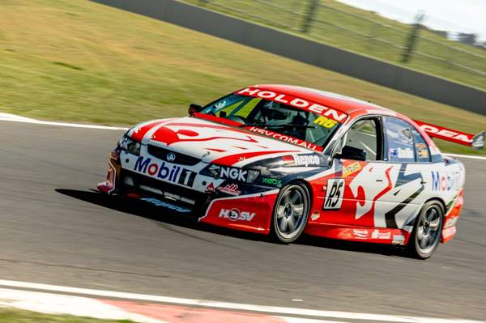
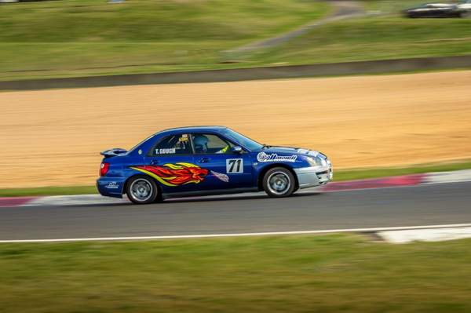
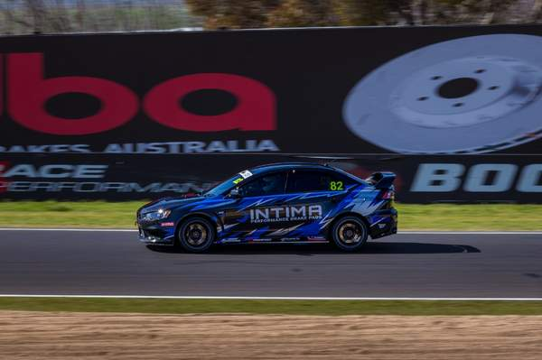

# Conrod

Fast vehicle keywording and culling for motorsport and automotive photography.

Conrod scans folders of RAW and JPEG frames to detect vehicles and people, measure subject sharpness, group bursts and moments, pick the best frame of each pass, read race numbers and plates, and identify make, model, and colour. Tags are written directly into industry-standard XMP sidecars for Lightroom, Photo Mechanic, Bridge, and Capture One.

Conrod is a native Windows app built with Rust, Tauri, and React. (The legacy Python release lives on the [`legacy-python`](../tree/legacy-python) branch).

## Installation

Download the latest release from [Releases](../releases):
- **Installer** (`Conrod-<v>-win64-setup.exe`): Per-user installation, no admin rights required.
- **Portable** (`Conrod-<v>-win64.zip`): Unzip and launch `Conrod.exe`.

*Note: Builds are not code-signed; Windows SmartScreen will ask for confirmation on first launch.*

### Setup & Requirements

- **Windows 10 or 11, 64-bit**, with the **WebView2** runtime (included in current Windows releases).
- **Batteries included**: the detector, plate reader, OCR, face, and grouping models and ExifTool ship with the app or download automatically on first run. A start-up splash shows each step.
- **Graphics card (optional)**: DirectML speeds up detection; without one, detection runs on the processor.
- **Optional AI**: make/model/colour needs a vision model. Use a local [Ollama](https://ollama.com/) server (`ollama pull qwen2.5vl:7b`), or add an OpenRouter or OpenCode Go key in **Settings > Identification > AI models**. A built-in vision model and a smaller decision model are planned, not shipped.
- **Lightroom (optional)**: the Conrod Bridge plug-in installs automatically when the Lightroom bridge is on, and can apply stars, picks, and colour labels straight to the catalog.
- **Existing Users**: libraries in `%USERPROFILE%\.conrod` (database, settings, models, Lightroom bridge packages) open automatically.
- See [`docs/user/ai-models.md`](docs/user/ai-models.md) for model choices, prices, and setup, and [`docs/wiki/`](docs/wiki/Home.md) for photographer-facing guides.

## Key Features

- **Non-destructive**: RAW files are never modified; metadata is written to `.xmp` sidecars. JPEGs update in place.
- **Scan queue**: start several albums; one scans at a time and the rest wait their turn. Pull a waiting album out with **Unqueue**, or pause, resume, and stop the running one.
- **Sharpness Scoring**: subject-level focus scoring that tells a soft frame from a sharp car against a deliberately streaked pan. A sharp frame is never demoted by composition, moments, or a burst suggestion.
- **AF-aware subject**: the car under the camera's autofocus area is the main subject; other cars in the frame are background and are dimmed in Review. Without usable AF data, the sharpest car is the subject.
- **Bursts and moments**: per-camera time bursts, optional look-alike merging, and a suggested keeper per stack. Moments (tyre smoke, a first kiss, a jump apex) lift ranking only inside a sharpness band.
- **Identify**: race numbers, plates, make/model/colour/team, sponsor livery, and names. Works with local Ollama, OpenRouter, or OpenCode Go, and still reads plates and numbers with the vision model off.
- **Entry List Matching**: drop in an event entry CSV (`number,driver,team,...`) to guarantee accurate keywords for competitors. (See [`samples/entries-example.csv`](samples/entries-example.csv)).
- **Folder Watch**: automatically processes new frames as they copy from memory cards.
- **Lightroom bridge**: export verdicts for the Conrod Bridge plug-in, or read flags back from Lightroom or a `.lrcat` catalog.
- **Formats**: tested on Canon `.cr3` and `.cr2`, alongside `.jpg` / `.jpeg`.

## Screens

- **Library**: every album, its progress, queue position, and the one-click **New scan** / **Resume** actions.
- **Ingest**: the live scan and the identification that follows it, with a flowchart of each stage and a log.
- **Review**: the cull — stacks, keepers, sharpness verdicts, detections, moments, identification, and Lightroom export.
- **Settings**: shoot defaults, AI models, identification, Lightroom, storage, and the vehicle registry.

## Quick start

1. Install Conrod and launch it. The splash opens the library, checks models and ExifTool, and reads the graphics card.
2. On first run, answer the setup wizard: the shoot types you photograph, how strict the blur check should be, and who is in your pictures.
3. Press **New scan**, choose the folder, pick the shoot type, and start. Frames from memory cards can also be watched with **Folder watch**.
4. When the scan finishes, Review opens on the suggested keepers. Rate, edit detections, then write XMP sidecars or export to Lightroom.

## Models & Pipeline

Each stage uses a dedicated, specialized model rather than a single monolithic multimodal model:

| Task | Model | Purpose |
|---|---|---|
| Vehicle Detection | YOLO11s (DirectML / GPU) | Fast bounding boxes (~17ms/frame) |
| Plate Detection | open-image-models | License plates & number roundels |
| Plate OCR | fast-plate-ocr | Dedicated plate character recognition |
| Livery & Numbers | PP-OCRv4 | Competition numbers and sponsor decals; fills a number only when the vision model missed one |
| Burst Grouping | DINOv2 (quantized) | Visual similarity clustering |
| Moments | Vision model or decision model | Tyre smoke, a kiss, a jump apex; same sharpness-band tie-break either way |
| Make, Model, Livery | Qwen2.5-VL 7B (Ollama), or a cloud vision model (OpenRouter / OpenCode Go) | Vehicle visual identification |

### Why Qwen2.5-VL 7B?

Tested against real circuit photography using Conrod's structured extraction prompt and schema:

| Target | Ground Truth | qwen2.5vl:7b (Local Ollama) | gpt-4o (OpenAI Cloud) |
|---|---|---|---|
| <br>*(Holden HRT)* | **Holden Commodore (VY/VZ)**<br>#R5, Saville<br>HRT / Mobil 1, HSV, Repco, NGK | **Make**: Holden, **Model**: HSV<br>**Number**: `R5` ✅<br>**Sponsors**: Mobil 1, NGK, Repco, HSV, Xbox ✅ | **Make**: Holden, **Model**: *null* ❌<br>**Number**: `05` ❌ *(hallucinated Brock)*<br>**Driver**: `Brock` ❌ *(hallucinated)* |
| <br>*(Subaru WRX)* | **Subaru Impreza WRX STI (Blobeye)**<br>#71, T. Gough<br>Marvell | **Make**: Subaru ✅, **Model**: Impreza ✅<br>**Number**: `71` ✅<br>**Driver**: `T. Gough` ✅ | **Make**: *null* ❌, **Model**: *null* ❌<br>**Number**: `71` ✅<br>**Driver**: `T. Gough` ✅ |
| <br>*(Lancer Evo X)* | **Mitsubishi Lancer Evolution X**<br>#82<br>Intima, Motul, Shockworks, Tyrepower | **Make**: Mitsubishi ✅, **Model**: Lancer Evolution ✅<br>**Number**: `82` ✅<br>**Sponsors**: Intima, Motul ✅ | **Make**: *null* ❌, **Model**: *null* ❌<br>**Number**: `82` ✅<br>**Sponsors**: Intima, Motul, Yokohama ✅ |

*Other local models tested:* `minicpm-v:8b` hallucinated a Mustang; `gemma3:4b` hallucinated a Mazda 323; `qwen3-vl:8b` failed JSON output structure. `qwen2.5vl:7b` identifies silhouettes accurately and runs locally in ~3.4s on an RTX 3070 Ti.

## Development & Build

Prerequisites: Rust (MSVC), C++ Build Tools, Node.js, and WebView2.

```powershell
# Install frontend dependencies
npm --prefix frontend ci

# Run development app
npm --prefix frontend run tauri -- dev

# Run tests and lints
cargo test --workspace
cargo clippy --workspace --all-targets -- -D warnings
npm --prefix frontend test

# Compile release installer
npm --prefix frontend run tauri -- build --ci
```

Output installer: `target/release/bundle/nsis/`.

See [`API.md`](API.md) for the internal command API and [`RELEASING.md`](RELEASING.md) for release workflows.

## Licensing

Detection uses Ultralytics YOLO (**AGPL-3.0**). Plate detection is **MIT**. Full third-party licenses and model hashes are tracked in [`scripts/assets.json`](scripts/assets.json).
