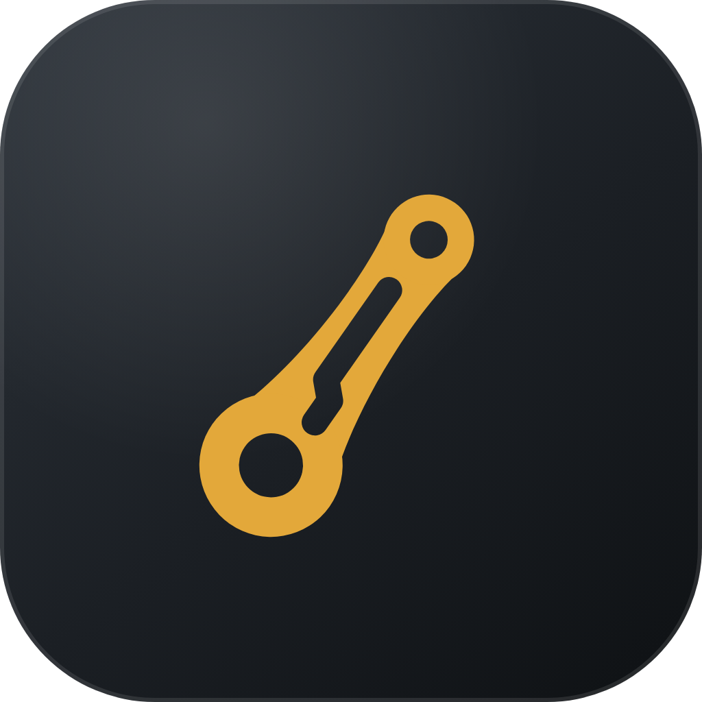
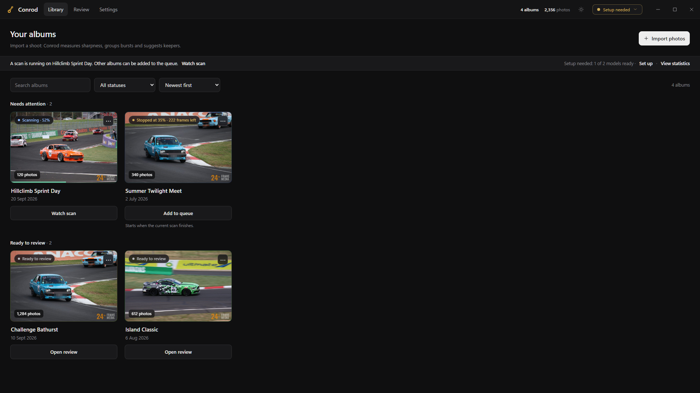
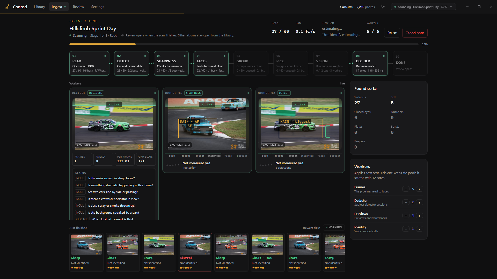
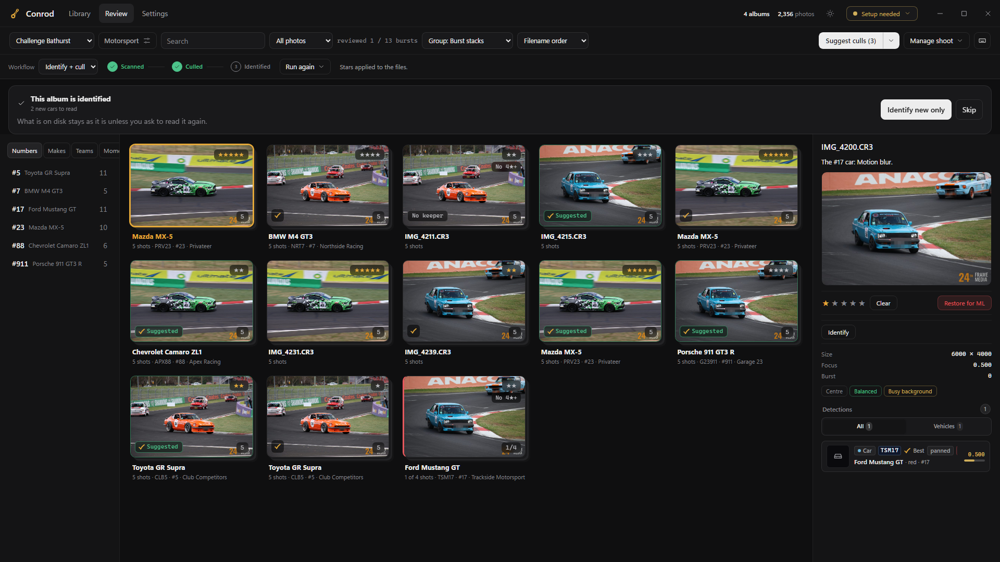
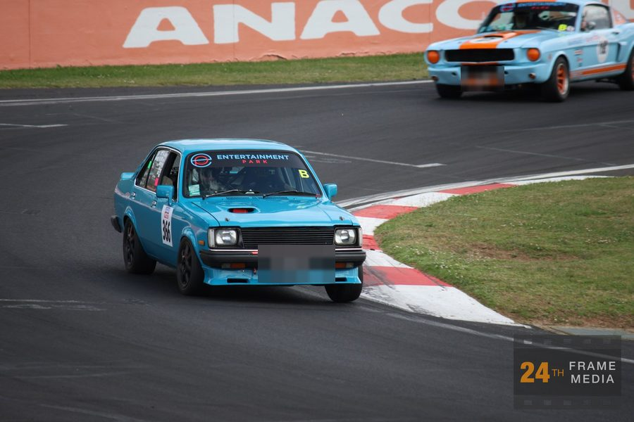
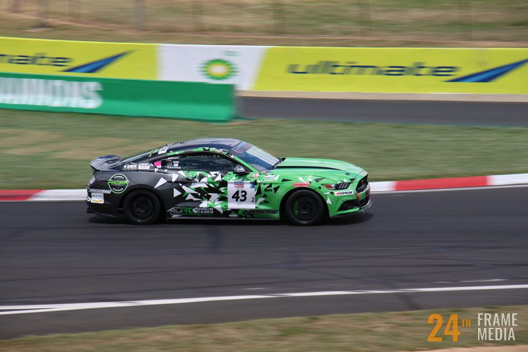
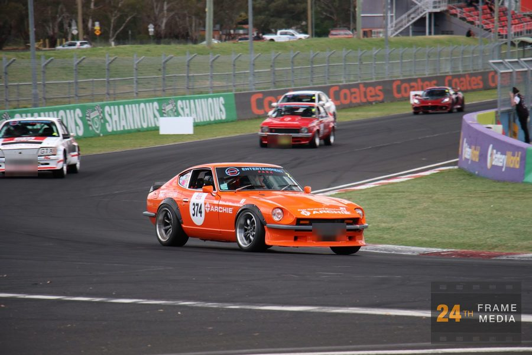

<div align="center">
  
</div>

<div align="center">
  <h1><b>Conrod</b></h1>
  <p><i>Conrod scans RAW and JPEG folders to find vehicles and people, cull frames, and write keywords to XMP sidecars.</i></p>
</div>

<h6 align="center">
  <a href="https://github.com/24th-Frame-Media/conrod/releases">Releases</a> &nbsp;|&nbsp; <a href="docs/wiki/Home.md">Wiki</a> &nbsp;|&nbsp; <a href="LICENSE">License</a>
</h6>

<div align="center">
  <a href="docs/images/screenshots/library.png"></a>
  <a href="docs/images/screenshots/ingest.png"></a>
  <a href="docs/images/screenshots/review.png"></a>
  <br>
  <sub>Library · Ingest · Review — click any image to open it full size</sub>
</div>

---

## Installation

Conrod is a native Windows app built with Rust, Tauri, and React. The legacy Python release lives on the [`legacy-python`](https://github.com/24th-Frame-Media/conrod/tree/legacy-python) branch.

Download the latest release from [Releases](https://github.com/24th-Frame-Media/conrod/releases):

| Build | File | Notes |
|:---|:---|:---|
| **Installer** | `Conrod-<v>-win64-setup.exe` | Per-user installation, no admin rights required. |
| **Portable** | `Conrod-<v>-win64.zip` | Unzip and launch `Conrod.exe`. |

*Note: Builds are not code-signed; Windows SmartScreen will ask for confirmation on first launch.*

---

## Requirements

- **Windows 10 or 11, 64-bit**, with the **WebView2** runtime (included in current Windows releases).
- The detector, plate reader, OCR, face, grouping models, and ExifTool ship with the app or download on first run. The start-up splash shows each step.
- **Graphics card (optional)**: DirectML speeds up detection; without one, detection runs on the processor.
- **Optional AI**: make/model/colour needs a vision model. Use a local [Ollama](https://ollama.com/) server (`ollama pull qwen3-vl:8b-instruct-q4_K_M`), or add an OpenRouter or OpenCode Go key in **Settings > Identification > AI models**. A built-in vision model and smaller decision model are planned, not shipped.
- **Lightroom (optional extra)**: Conrod writes stars, picks, and colour labels straight into your files by default, so Lightroom sees them without anything else installed. An optional Conrod Bridge plug-in can apply them live to the catalog.
- **Existing Users**: libraries in `%USERPROFILE%\.conrod` (database, settings, models, Lightroom bridge packages) open automatically.
- See [`docs/user/ai-models.md`](docs/user/ai-models.md) for model choices, prices, and setup, and [`docs/wiki/`](docs/wiki/Home.md) for photographer-facing guides.

---

## Features & Guides

Step-by-step guides live in the [wiki](docs/wiki/Home.md). Each feature links to the page that walks through it.

### [Getting started](docs/wiki/Getting-started.md)
1. Install Conrod and launch it. The splash opens the library, checks models and ExifTool, and reads the graphics card.
2. On first run, answer the setup wizard: the shoot types you photograph, how strict the blur check should be, and who is in your pictures.
3. Press **New scan**, choose the folder, pick the shoot type, and start. Frames from memory cards can also be watched with **Folder watch**.
4. When the scan finishes, Review opens on the suggested keepers. Rate, edit detections, then write XMP sidecars or export to Lightroom.

### [Albums and scanning](docs/wiki/Albums-and-scanning.md)
Start several albums; one scans at a time and the rest wait their turn. Pull a waiting album out with **Unqueue**, or pause, resume, and stop the running one. **Folder Watch** automatically processes new frames as they copy from memory cards.

### [How culling works](docs/wiki/How-culling-works.md)
- **Non-destructive**: RAW files are never modified; metadata is written to `.xmp` sidecars for Lightroom, Photo Mechanic, Bridge, and Capture One. JPEGs update in place.
- **Sharpness scoring**: subject-level focus scoring distinguishes a soft frame from a sharp car against a streaked pan. Composition, moments, and burst suggestions never demote a sharp frame.
- **AF-aware subject**: the car under the camera's autofocus area is the main subject; other cars in the frame are background and are dimmed in Review. Without usable AF data, the sharpest car is the subject.
- **Bursts and moments**: per-camera time bursts, optional look-alike merging, and a suggested keeper per stack. Moments (tyre smoke, a first kiss, a jump apex) affect ranking only within a sharpness band.
- **Formats**: tested on Canon `.cr3` and `.cr2`, alongside `.jpg` / `.jpeg`.

### [Identify](docs/wiki/Identify.md)
Race numbers, plates, make/model/colour/team, sponsor livery, and names. Works with local Ollama, OpenRouter, or OpenCode Go, and still reads plates and numbers with the vision model off. **Entry List Matching**: drop in an event entry CSV (`number,driver,team,...`) to guarantee accurate keywords for competitors (see [`samples/entries-example.csv`](samples/entries-example.csv)).

### [Lightroom integration](docs/wiki/Lightroom-integration.md)
Stars, picks, and colour labels written to your files; an optional plug-in applies them in Lightroom. Conrod can read flags from the plug-in or a `.lrcat` catalog.

### [Settings reference](docs/wiki/Settings-reference.md) · [Recommended setups](docs/wiki/Recommended-setups.md) · [Troubleshooting](docs/wiki/Troubleshooting.md) · [Roadmap](docs/wiki/Roadmap.md)
Shoot defaults, AI models, identification, Lightroom, storage, and the vehicle registry all live in **Settings**.

### Screens
- **Library**: every album, its progress, queue position, and the one-click **New scan** / **Resume** actions.
- **Ingest**: the live scan and the identification that follows it, with a flowchart of each stage and a log.
- **Review**: the cull — stacks, keepers, sharpness verdicts, detections, moments, identification, and Lightroom export.
- **Settings**: shoot defaults, AI models, identification, Lightroom, storage, and the vehicle registry.

---

## Models

| Task | Model | Purpose |
|---|---|---|
| Vehicles | YOLO26m (DirectML / GPU) | Every car in our hardest 40-frame test set (40/40, up from 36/40); ~30% slower than YOLO11s |
| Plates | open-image-models | License plates & number roundels |
| Plate text | fast-plate-ocr | Dedicated plate character recognition |
| Livery & numbers | PP-OCRv4 | Competition numbers and sponsor decals; fills a number only when the vision model missed one |
| Burst groups | DINOv2 (quantized) | Visual similarity clustering |
| Moments | Vision model or decision model | Tyre smoke, a kiss, a jump apex; same sharpness-band tie-break either way |
| Make/model/livery | Qwen3-VL 8B (Ollama), or a cloud vision model (OpenCode credits / OpenRouter) | Vehicle visual identification |

Best free: **qwen3-vl:8b** on your own PC.  
Best paid value: **gpt-6-luna** at about **$0.42 per 1,000 cars**.  
[See all 10 models](#benchmark-details).

---

## Benchmark

<details id="benchmark-details">
<summary>Benchmark details (22 Nov 2026, 3 frames, 10 models)</summary>

<table>
<tr>
<td><br>Blue Holden Gemini · door 366</td>
<td><br>Black and green Ford Mustang · door 43</td>
<td><br>Orange Datsun 240Z · door 374</td>
</tr>
</table>

| Model | What it is | Where it runs | Cars right | Numbers right | Sponsors found | Speed | Cost per 1,000 cars | Verdict |
|---|---|---|---|---|---|---|---|---|
| qwen3-vl:8b-instruct-q4_K_M | Small open vision model (8B) | Your own PC | 2/3 | 3/3 | 11/16 | about 9 s | $0 (own hardware) | Winner |
| glm-5.3-flash | Fast cloud model (current default) | Cloud | 2/3 | 3/3 | 8/16 | about 6 s, one 52 s | $1.73 | Baseline |
| gpt-6-luna | Cheap general-purpose GPT | Cloud | 2/3 | 3/3 | 8/16 | about 8 s | $0.42 | Value |
| minimax-m3.1-flash* | Cheapest very fast model | Cloud | 2/3 | 3/3 | 5/16 | about 2 s | $0.41 | Unreliable |
| claude-haiku-5-5 | Small Claude | Cloud | 1/3 | 3/3 | 7/16 | about 4 s | $0.38 | Solid |
| gemini-3.5-flash-lite | Cheapest Gemini | Cloud | 2/3 | 3/3 | 12/16 | about 22 s, frequent retries | $0.88 | Bursty |
| qwen2.5vl:7b | Older open vision model (7B) | Your own PC | 1/3 | 3/3 | 9/16 | about 5 s | $0 (own hardware) | Aging |
| deepseek-v4.1-flash | Reasoning model | Cloud | 2/3 | 2/3 | 6/16 | about 59 s | $3.59 | Overkill |
| strata/qwen3.8-flash-next-coder-iq1_m | Self-hosted model | Your own PC (self-hosted) | 1/3 | 3/3 | 7/16 | about 92 s | $0 (self-hosted) | Slow |
| mimo-iq4:latest | Small open model (4-bit) | Your own PC | 0/3 | 1/3 | 3/16 | about 15 s | $0 (own hardware) | Avoid |

\* `minimax-m3.1-flash` was unavailable upstream; the row is its sibling `minimax-m3`.

Cars right = make and model both correct. Numbers right = door number exact.
Sponsors found = out of 16 across the three cars. Local rows use the reader's own GPU;
cloud rows are one provider's pay-as-you-go list rate, one image per car.
</details>

---

## Building

Prerequisites: Rust (MSVC), C++ Build Tools, Node.js, and WebView2.

```powershell
# Install frontend dependencies
npm --prefix frontend ci

# Run development app
npm --prefix frontend run tauri -- dev

# Run tests and lints
cargo test --workspace
cargo clippy --workspace --all-targets -- -D warnings
npm --prefix frontend test

# Compile release installer
npm --prefix frontend run tauri -- build --ci
```

Output installer: `target/release/bundle/nsis/`.

See [`API.md`](API.md) for the internal command API and [`RELEASING.md`](RELEASING.md) for release workflows.

---

## License

Detection uses Ultralytics YOLO (**AGPL-3.0**). Plate detection is **MIT**. Because Conrod links an AGPL-3.0 detector, the project is **AGPL-3.0** as well; the full text is in [`LICENSE`](LICENSE). Full third-party licenses and model hashes are tracked in [`scripts/assets.json`](scripts/assets.json).
