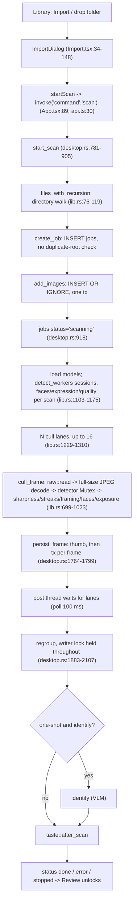
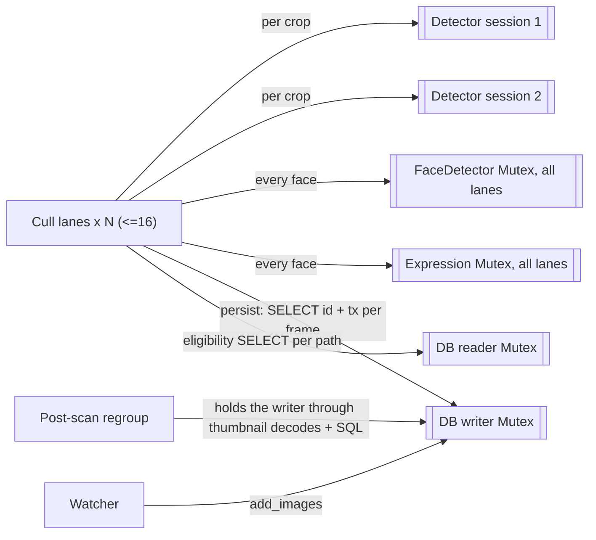
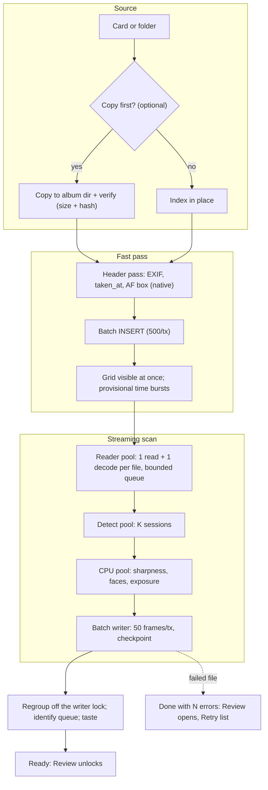
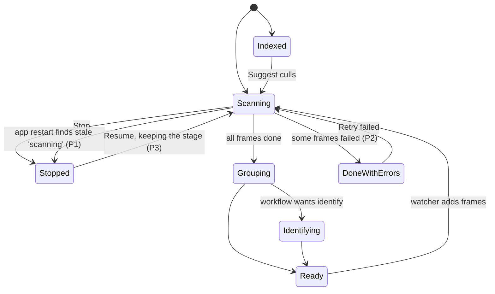

# Ingest flow review (2026-11-19)

Haiku read-only map of the ingest path (folder pick -> scan -> post-scan -> Review), spot-checked by Opus.
The section numbers match the original report. Effort: S/M/L. Accuracy risk relates to sharpness, burst and keeper results.

## Headlines
- **No card import.** Import indexes the folder in place (`desktop.rs:825`, `lib.rs:1061`). Nothing is copied, verified or ejected.
- **Re-importing a folder makes a second album.** `create_job` is unconditional (`desktop.rs:900`).
- **A crash mid-scan strands the album.** It stays `status='scanning'`, which hides Resume (`Library.tsx:30`) and still lets Review open (`App.tsx:53,123`).
- **One unreadable file fails the whole album.** `incomplete` counts `status!='done'` (`desktop.rs:1052-1062`).
- **Library Resume drops the stage.** `ScanArgs.stage` defaults to Cull, so identify is skipped (`commands.rs:89`, `desktop.rs:971,1014`).
- **The pipeline view is partly fiction.** read, detect, sharpness and faces all advance together after each frame (`lib.rs:1301-1304`), so per-stage rates are identical and `queue_len` is always 0. The worker counts shown are lane counts, not the real pools (2 detector sessions; one face Mutex).
- **AF is not part of ingest.** `focus_points` is never run by the scan and has no frontend caller. The default "Anchor on the focus area" grouping, and the AF rescue, are no-ops until someone runs it. Confirmed: job 109 has 0 of 847 frames with an AF box.

## 1. Current flow


```mermaid
sequenceDiagram
  participant UI
  participant TK as Tauri ticker 250 ms
  participant EN as Engine
  participant PR as Progress
  UI->>EN: invoke scan
  EN-->>UI: jobId at once
  loop every 250 ms
    TK->>PR: snapshot()
    TK-->>UI: scan-progress (7 nodes, lanes, recent, found, overall)
  end
  loop each frame
    EN->>PR: busy(stage, file) / waiting('detect') / recent(thumb, verdict)
  end
  EN->>PR: phase group, then pick (no per-item progress); identify; taste (no node)
  TK-->>UI: final state done/stopped/error
```

## 2. Concurrency as built

Frames wait on the detector sessions (about 8 lanes per session at defaults), on the face and expression Mutexes (this wait is not reported), and on the writer lock while regroup runs. Paused lanes still show `busy`.

## 3. Pain points
Numbering follows the original report; the items not listed here are covered by the headlines.

| # | Pain point |
|---|---|
| 5 | Files changed under the same name are never re-read (`INSERT OR IGNORE`, resume skips `done`). |
| 6 | Files added during a scan are missed: the watcher is off while scanning. |
| 7 | Stopped albums are never grouped but Review still opens. |
| 8 | Pause is not shown in the lane view. |
| 10 | `preview_workers` doesn't affect the scan. |
| 11 | Group and pick have no per-item progress, and taste has no node. |
| 13 | The worker default differs between `worker_limits` and `cull_workers`. |
| 15 | Dead time before the first thumbnail (model loads) and after the last frame (regroup, identify, taste). |
| 17 | Full-resolution decode per frame. |
| 18 | `raw::read` opens each file twice (rawler metadata). `focus_points` re-reads every RAW. |
| 19 | Detect is the serial stage, and its sessions are reloaded every scan. |
| 21 | One commit and one `SELECT id` per frame. No `cache_size` or `mmap_size` PRAGMAs. |
| 22 | Regroup holds the writer lock. |
| 25 | The watcher stats the whole tree every pass (11 s on 9,500 USB files). |
| 28 | `focus_points` falls back to exiftool on the bare PATH, with no presence check first. |

## 4. Proposed flow




| # | Proposal | Effort | Accuracy risk |
|---|---|---|---|
| P1 | On startup, reconcile stale `scanning` jobs to `stopped`; gate Review on status | S | none |
| P2 | Album finishes as done-with-errors; Review opens; Retry list for failed files | S | none |
| P3 | Resume keeps the album's stage | S | none |
| P4 | Honest per-stage counters and real pool sizes; identify shown `off` when unused; taste node; group/pick progress | S-M | none |
| P5 | Paused lanes shown as waiting | S | none |
| P6 | Wire `preview_workers` into the scan or remove it | S | none |
| P7 | Reader pool, then bounded detect pool, then CPU pool | M | none |
| P8 | Keep model sessions across scans | S | none |
| P9 | Measure before reducing decode size | S | high if changed |
| P10 | Header fast pass for an instant grid | M | none (provisional bursts only) |
| P11 | Batched writer, cached ids, PRAGMAs | M | none |
| P12 | Regroup off the writer lock; `look` at persist time | M | none |
| P13 | Re-import of a known root offers "add new frames" | S | none |
| P14 | Optional verified card copy (single-pass later) | M-L | none |
| P15 | AF box read natively at scan time, replacing the manual exiftool pass | M | low |
| P16 | Streaming group and pick per closed burst | L | low-med |
| P17 | Watcher stats only new names | S | none |
| P18 | Removable-drive awareness | S-M | none |

## 5. Top 8
1. P1 + P2: crash reconcile and done-with-errors.
2. P3: Resume keeps the stage.
3. P4 + P5: honest pipeline view.
4. P13: re-import guard.
5. P10 + P11: instant grid and batched commits.
6. P7 + P8: read/decode pool feeding the detect pool; models kept loaded.
7. P12: regroup off the writer lock.
8. P14, then P15: verified card copy, then AF in the scan.

Measure per-stage time per frame first; the honest counters in P4 provide those numbers.
